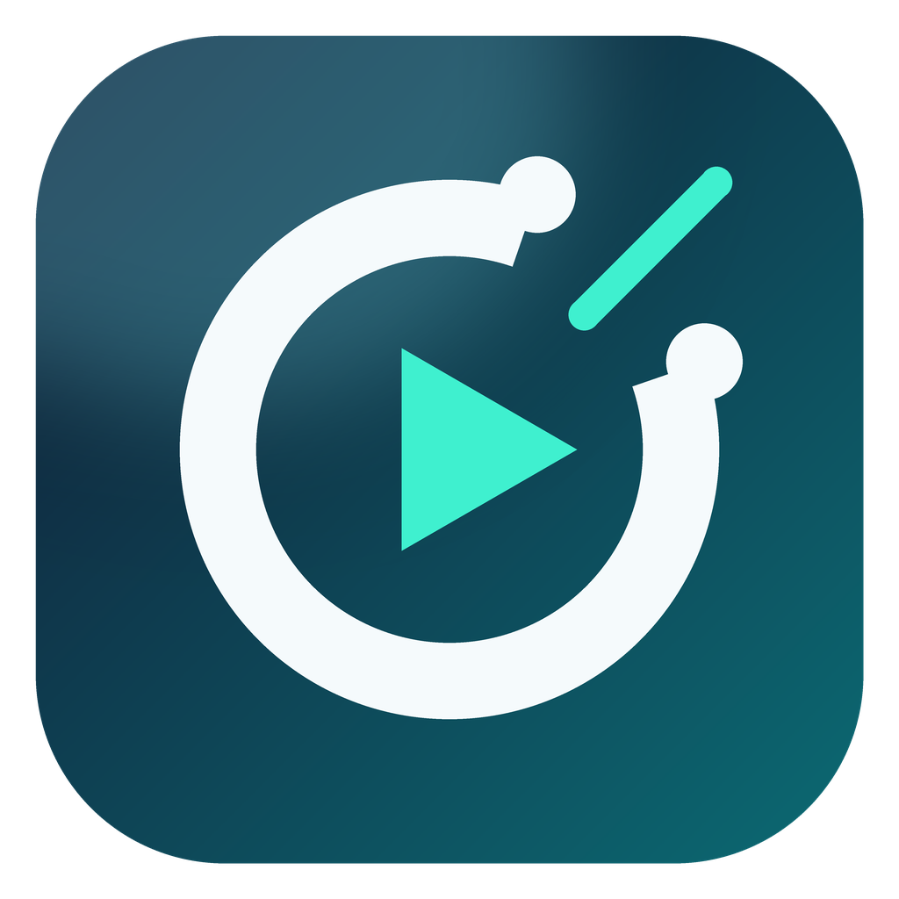

<p align="center">
  
</p>

<h1 align="center">PanoCut</h1>

<p align="center">Videoschnitt für 360°-, Kamera- und Drohnenvideos – alles in einem Programm.<br/>Für Mac und Windows. Auf Deutsch. Kostenlos.</p>

---

## Installieren

Die fertigen Installer liegen unter **[Releases](https://github.com/BlayZzo/pano-cut/releases/latest)**.

| System | Datei | Hinweis |
|---|---|---|
| **Mac mit Apple-Chip** (M1–M4) | `PanoCut-x.y.z-mac-arm64.dmg` | DMG öffnen, PanoCut in „Programme“ ziehen |
| **Mac mit Intel** | `PanoCut-x.y.z-mac-x64.dmg` | wie oben |
| **Windows 10/11** | `PanoCut-x.y.z-win-x64.exe` | Installer starten (Desktop-Icon wird angelegt) |

**Erster Start auf dem Mac:** PanoCut ist (noch) nicht bei Apple registriert. Beim ersten Öffnen sagt macOS deshalb, die App könne nicht geprüft werden. So geht es trotzdem:

1. PanoCut einmal doppelklicken (es erscheint die Warnung – „Fertig“ klicken).
2. **Systemeinstellungen → Datenschutz & Sicherheit** öffnen, nach unten scrollen und bei PanoCut auf **„Trotzdem öffnen“** klicken.

Das ist nur beim allerersten Start nötig. Alternativ im Terminal: `xattr -dr com.apple.quarantine /Applications/PanoCut.app`

**Windows:** Beim ersten Start kann der SmartScreen-Filter warnen („Unbekannter Herausgeber“). Auf **„Weitere Informationen“ → „Trotzdem ausführen“** klicken.

### Deinstallieren

- **Mac:** Menü **PanoCut → PanoCut deinstallieren …** (legt die App in den Papierkorb und löscht Cache und Einstellungen).
- **Windows:** Startmenü → **PanoCut deinstallieren**, oder über „Apps & Features“. Der Deinstaller entfernt auch Cache und Einstellungen.

Deine Videos und Projektdateien (`.panocut`) bleiben in beiden Fällen erhalten.

### Updates

PanoCut prüft beim Start, ob es eine neue Version gibt, und zeigt dann oben eine Leiste.
- **Windows:** Update herunterladen → installieren (automatisch).
- **Mac:** Update herunterladen → der Installer öffnet sich; PanoCut neu in „Programme“ ziehen.

Außerdem: **Hilfe → Nach Updates suchen …**

---

## So funktioniert's

1. **Importieren** – Videos, Bilder und Musik per Drag & Drop in die Mediathek ziehen (oder „Importieren“, für ganze Ordner „📁 Ordner“). PanoCut erzeugt im Hintergrund kleine Vorschau-Dateien, damit alles flüssig läuft – auch bei 4K und 360°. Liegen Kamera-Vorschaudateien daneben (DJI `.LRF`, GoPro/Insta360 `.LRV`), werden sie mit dem Video gebündelt: sofort bereit, Export trotzdem aus dem Original. „🔍 Original“ unter der Vorschau zeigt die echte Qualität.
2. **Hover-Vorschau** – mit der Maus über eine Kachel fahren, um den Clip grob durchzuspulen.
3. **In die Timeline ziehen** – Clips auf die Video- oder Audiospuren ziehen. Sie rasten an anderen Clips und am Abspielkopf ein.
4. **Schneiden** – Abspielkopf setzen und **S** drücken (oder die Schere). Ränder ziehen zum Trimmen.
5. **Bearbeiten** – im Inspektor rechts: **Tempo** (Zeitlupe/Zeitraffer), **Rückwärts**, **Lautstärke** mit Ein-/Ausblenden, **Position & Größe**, **Deckkraft**.
6. **Bild** – **✦ Natürlich schön** verbessert das Bild automatisch (nur wenn du klickst). Dazu Looks (Kino, Warm, Teal & Orange, Drohne …), Belichtung, Lichter/Tiefen, Weißabgleich, Dynamik, Verblassen, Dunst entfernen und eigene **LUTs (.cube)** – z. B. für DJI D-Log oder Blackmagic Film.
7. **Effekte & Animationen** – im Reiter **Effekte** einen Baustein (Ken Burns, Hereinschieben, Aufploppen, Wackeln, Looks, Vignette, Filmkorn …) auf einen Clip ziehen. Im Inspektor lassen sich Stärke und eigene **Keyframes** einstellen; mit „Als eigenen Effekt speichern“ entstehen **eigene Bausteine**.
8. **360°** – Insta360-Dateien werden beim Import zusammengesetzt. Clip auswählen und in der Vorschau mit der Maus **umschauen** (Mausrad = zoomen). Im Inspektor die Ansicht wählen (Ausschnitt, ganzes Panorama, Little Planet) und mit **Keyframes** eine Kamerafahrt anlegen.
9. **Übergänge & Titel** – im Reiter „Übergänge“ einen Übergang auf einen Clip ziehen; im Reiter „Titel“ eine Vorlage auf eine Videospur ziehen und den Text im Inspektor ändern.
10. **Untertitel** – Clip auswählen → Inspektor → „Untertitel automatisch erzeugen“. Das Sprachmodell wird beim ersten Mal geladen; alles läuft auf deinem Rechner. Für Social Media: Vorlage wählen (das gesprochene Wort leuchtet auf). **Übersetzen** zwischen Deutsch und Englisch läuft ebenfalls lokal (Übersetzer aus Firefox) – die zweite Sprache steht darunter oder ersetzt das Original.
11. **KI** – in der Vorschau auf **✦ KI** klicken: „Objekte erkennen“ → beim gewünschten Objekt „Verfolgen“ → „Maske berechnen“. Danach ist der Clip freigestellt (Inspektor → „Objekte (KI)“). Mit „In Objekt-Mediathek kopieren“ landet das Objekt im Reiter **Objekte** und lässt sich über andere Videos legen. Titel und Untertitel können im Inspektor **an ein Objekt geheftet** werden.
12. **Green Screen** – Clip auswählen → Inspektor → „Green Screen“ → „Aus Vorschau wählen“ und auf den Hintergrund klicken.
13. **Effekt-Studio** – unter der Vorschau auf **✦ Effekt** klicken und beschreiben, was passieren soll („große Explosion mit viel Rauch“, „leichter Schneefall“, „Gewitter“ …). Der Effekt wird auf deinem Rechner simuliert, an die Szene angepasst (Helligkeit, Farbe, Lichtschein, Schatten) und als Ebene eingefügt. In der Vorschau ziehen = platzieren, Mausrad = Größe, Umschalt + ziehen = drehen.
14. **Ebenen** – im Inspektor unter „Ebene“: Mischmodus (z. B. Negativ multiplizieren für Licht) und Schlagschatten. Spuren mit ▲▼ nach vorne oder hinten. Ein freigestelltes Objekt lässt sich im Bereich „Objekte (KI)“ mit **„Vor andere Ebenen holen“** ganz nach vorne legen – z. B. fährt ein Auto dann durch einen Text. Masken lassen sich mit dem **Pinsel** nachbessern.
15. **Bild-Assistent** – unter der Vorschau auf **✦ Bild**: PanoCut erkennt zu dunkle, zu helle, flaue oder flackernde Clips (z. B. Tunnelfahrten) und passt sie mit einem Klick an – auf Wunsch mit Helligkeit, die sich über die Zeit angleicht. „Vorher“ gedrückt halten zum Vergleichen. Kamera-Profile für **Blackmagic Film** und **DJI D-Log** wandeln flache Log-Aufnahmen in natürliche Farben um.
16. **Musik-Schnitt** – Musik-Clip auswählen: Der **Takt** wird automatisch erkannt (Taktmarken in der Timeline, Clips rasten darauf ein). „**Auf den Takt schneiden**“ verteilt deine Video-Clips so, dass jeder Schnitt genau auf einem Schlag liegt – mit Zoom-Stoß, Wackeln oder weißem Blitz auf der Takt-Eins.
17. **Dynamische Übergänge** – im Reiter „Übergänge“ → „Dynamisch“: Zoom-Durchflug, Wisch-Schwenk, Drehung, Blitz, Wackeln, Glitch – jeweils mit einstellbarer **Stärke**.
18. **Kamerafahrten für 360°** – im Inspektor unter „360°-Ansicht“: Rundum-Schwenk, Peitschen-Schwenk 180°, Planet → Normal, Zoom-Stoß, Drohnen-Aufstieg, Fassrolle u. a. ab dem Abspielkopf einfügen. **Tempo-Rampen** (schnell → Zeitlupe → schnell, Hero-Moment …) im Bereich „Geschwindigkeit“.
19. **Objekt ins Video fallen lassen** – ein freigestelltes Objekt oder 3D-Objekt auswählen → Inspektor → „Auftritt“: Herabfallen mit Aufprall, Aufschlagen, Hereinrasen … Beim Aufprall entstehen Staubwolke (in der Farbe des Bodens) und Trümmer, das Bild wackelt – alles mit **Stärke**.
20. **Mehrkamera** – mehrere Clips verschiedener Kameras auswählen → „Mehrkamera erstellen“. PanoCut synchronisiert sie über den **Ton**. Unter der Vorschau erscheinen alle Kameras; mit den Tasten **1–9** (oder Stream Deck „Kamera 1–4“) wird umgeschnitten – auch live beim Abspielen. „Automatisch wechseln“ schneidet im Takt der Musik.
21. **3D-Objekte** – auf **🧊 3D** klicken (oder eine 3D-Datei importieren): **glTF/GLB, OBJ, FBX, STL**. Bewegung (Drehteller, Schweben, Hereindrehen, Animation der Datei …), Ansicht, Licht und Bodenschatten einstellen – „**Licht an das Video anpassen**“ übernimmt Richtung, Farbe und Helligkeit aus deinem Video. Das Objekt wird als Ebene mit Transparenz eingefügt.
22. **Exportieren** – **⌘/Strg + E**: Preset wählen (Handy 9:16, Quadrat, Full HD, 4K, WhatsApp, ProRes, GIF, 360°), Qualität oder **maximale Dateigröße** einstellen, fertig. Auf dem Mac danach direkt **„In Fotos importieren“** – und von dort per WhatsApp teilen.

**Musik leiser beim Sprechen (Ducking):** Musik-Clip auswählen → Inspektor → Ton → „Leiser, wenn gesprochen wird“.

**Rückgängig** mit ⌘/Strg + Z, so oft du willst. Alle Tastenkürzel unter **Hilfe → Tastenkürzel**.

### Elgato Stream Deck

1. In den Downloads der aktuellen Version **`PanoCut.streamDeckPlugin`** laden und doppelt anklicken – die Stream-Deck-App installiert das Plugin.
2. In der Stream-Deck-App gibt es dann die Kategorie **PanoCut** mit 26 Tasten: Abspielen/Pause, Schneiden, Löschen, Rückgängig, Wiederholen, Anfang/Ende markieren, Bild vor/zurück, Zum Anfang/Ende, Schleife, Duplizieren, Zoom, **Natürlich schön**, **KI**, Importieren, Speichern, Exportieren und **Kamera 1–4** für den Mehrkamera-Schnitt.
3. PanoCut muss laufen. Die Verbindung bleibt auf deinem Rechner (Einstellungen → „Stream Deck & Fernsteuerung“).

Ohne Plugin geht es auch mit der Stream-Deck-Aktion **„Tastenkombination“** – z. B. ⌘B / Strg+B (Schneiden), ⌘⇧E / Strg+Umschalt+E (Natürlich schön), ⌘L / Strg+L (Schleife), ⌘⇧K / Strg+Umschalt+K (KI).

### Unterstützte Dateien

- **Video:** MP4, MOV, M4V, MKV, AVI, WebM, MTS/M2TS, MXF, Insta360 `.insv`/`.lrv`, GoPro `.360`
- **Audio:** MP3, WAV, AAC/M4A, FLAC, OGG, AIFF
- **Bilder:** JPG, PNG, WebP, GIF, BMP, TIFF, HEIC, Insta360 `.insp`
- **3D-Modelle:** glTF/GLB (auch Draco-komprimiert), OBJ, FBX, STL

> **Blackmagic:** ProRes- und H.264/H.265-Aufnahmen funktionieren; für Aufnahmen in **Blackmagic Film** gibt es im Bild-Assistenten ein passendes Kamera-Profil. **Blackmagic RAW (.braw)** lässt sich nur mit Blackmagics eigener (nicht freier) Software lesen – bitte in DaVinci Resolve (kostenlos) als ProRes exportieren und dann in PanoCut importieren.
> **Insta360:** `.insv`- und `.lrv`-Rohdateien werden automatisch zusammengesetzt. Die Naht ist nicht ganz so perfekt wie in Insta360 Studio (dort werden Kalibrierdaten der Kamera benutzt); im Inspektor lässt sich das Linsen-Sichtfeld feinjustieren. Bereits in Insta360 Studio exportierte 360°-Videos (2:1) werden ebenfalls erkannt.

---

### Eigene Cloud

In den Einstellungen lässt sich eine WebDAV-Adresse eintragen (z. B. Nextcloud: `https://deine-cloud.de/remote.php/dav/files/NAME/PanoCut`). Dann können Objekte gesichert/geholt und Exporte direkt hochgeladen werden. Es werden keine fremden Dienste benutzt.

## Fahrplan

| Version | Inhalt |
|---|---|
| **0.1** ✅ | Mediathek mit Hover-Vorschau, Timeline (Spuren, Schneiden, Trimmen, Einrasten), Tempo/Zeitlupe/Zeitraffer, Rückwärts, Bild- und Tonbearbeitung, Export-Presets, Fotos-Import (Mac), Auto-Update, Installer/Deinstaller |
| **0.2** ✅ | 360°: Stitching der Insta360-Rohdateien, Umschauen in der Vorschau, Kamerafahrten mit Keyframes, Little Planet, 360°-Export mit Metadaten · 20 Übergänge · Titel-Vorlagen · Stabilisierung · automatische Untertitel (lokal) · Export mit Größenlimit |
| **0.3** ✅ | KI-Button: Personen, Tiere und Objekte erkennen und verfolgen · KI-Masken · Freistellen · Green Screen · Titel/Untertitel an Objekte heften · Objekt-Mediathek · eigene Cloud (Nextcloud/WebDAV) |
| **0.4** ✅ | Effekt- und Animations-Bibliothek · eigene Effekte · Keyframes · Looks und LUTs · „Natürlich schön“ (automatische Bildverbesserung auf Wunsch) · Zuschneiden/Spiegeln · Audio-Ducking · Übersetzung von Untertiteln · Elgato Stream Deck |
| **0.5** ✅ | Effekt-Studio: Effekte beschreiben und simulieren (Explosion, Feuer, Rauch, Schnee, Regen, Nebel, Funken, Blitz, Staub, Konfetti), an die Szene anpassen (Licht, Schatten, Farbe, Erschütterung) · Ebenen mit Mischmodi und Schatten · Objekt vor andere Ebenen holen · Masken-Pinsel · Platzieren direkt in der Vorschau |
| **0.6** ✅ | Bild-Assistent für zu dunkle/helle Clips · Kamera-Profile (Blackmagic Film, DJI D-Log) · Auto-Musik-Schnitt mit Takterkennung · dynamische Übergänge mit Stärke · 360°-Kamerafahrten · Tempo-Rampen · Objekte ins Video fallen lassen (Aufprall, Staub, Trümmer) · Mehrkamera mit Ton-Synchronisierung · 3D-Objekte (glTF, OBJ, FBX, STL) · Stream Deck „Kamera 1–4“ |
| **0.7** ✅ | Social-Media-Untertitel (Wort leuchtet, Vorlagen) · Übersetzung Deutsch ↔ Englisch lokal · neue Effekte (Linsenreflex, Bokeh, Speed-Linien, Lichtlecks, Herzen, Glitzer) · schnellere Vorschau, Proxys per Grafikchip auf dem Mac |
| **0.8** ✅ | Sound-Effekte · Per Klick freistellen · Vorbeifahrt-Rampen · Glühen/Leuchtspuren/Bewegungsunschärfe · Hochformat folgt Objekt · Hook-Finder · Cover · Grobschnitt · Projekt-Vorlagen · TikTok/Reels/Shorts mit Lautheit · Export im Hintergrund · Ordner beobachten · Speicher aufräumen · alles in Kategorien |
| **0.9** | Mehrkamera-Winkel in der Timeline bearbeiten · weitere Effekte (Wasser, Glas) · bei Bedarf zweites Programm für Bild-/Objektbearbeitung |

Alles läuft lokal auf deinem Rechner – ohne Abo, ohne Cloud-Zwang.

---

## Für Entwickler

```bash
npm install          # Abhängigkeiten (lädt FFmpeg für dein System)
npm run dev          # Entwicklung mit Live-Reload
npm run typecheck    # TypeScript prüfen
npm run package      # Installer für das aktuelle System bauen (→ release/)
```

**Neue Version veröffentlichen:** `RELEASE_NOTES.md` aktualisieren, Version in `package.json` erhöhen, committen und auf `main` pushen – GitHub Actions erkennt die neue Version, baut die Mac- und Windows-Installer und veröffentlicht sie als Release. (Alternativ: Tag setzen oder den Release-Workflow manuell starten.)

```bash
npm version patch --no-git-tag-version   # z. B. 0.1.0 → 0.1.1
git commit -am "Version 0.1.1" && git push
```

Installierte PanoCut-Versionen finden das Update automatisch.

### Aufbau

```
src/main/      Electron-Hauptprozess: FFmpeg, Medien-Import, Export, Projektdateien, Updates
src/renderer/  Oberfläche (React): Mediathek, Vorschau-Engine, Timeline, Inspektor, Dialoge
src/shared/    Gemeinsame Typen und Timeline-Logik
build/         Icon, Installer-Texte
```

PanoCut basiert auf [Electron](https://www.electronjs.org/) und [FFmpeg](https://ffmpeg.org/). Lizenz: MIT.
